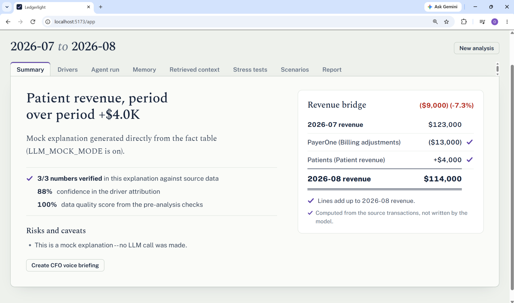
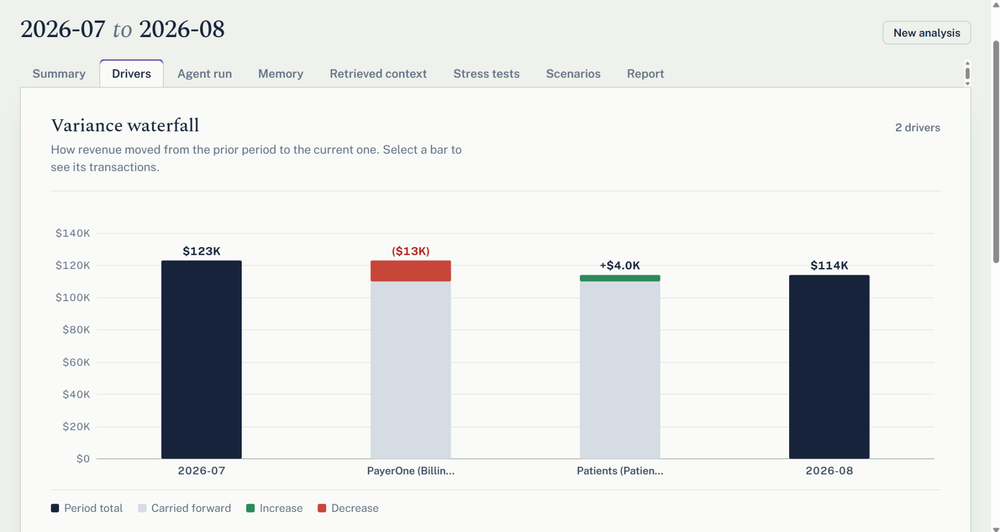
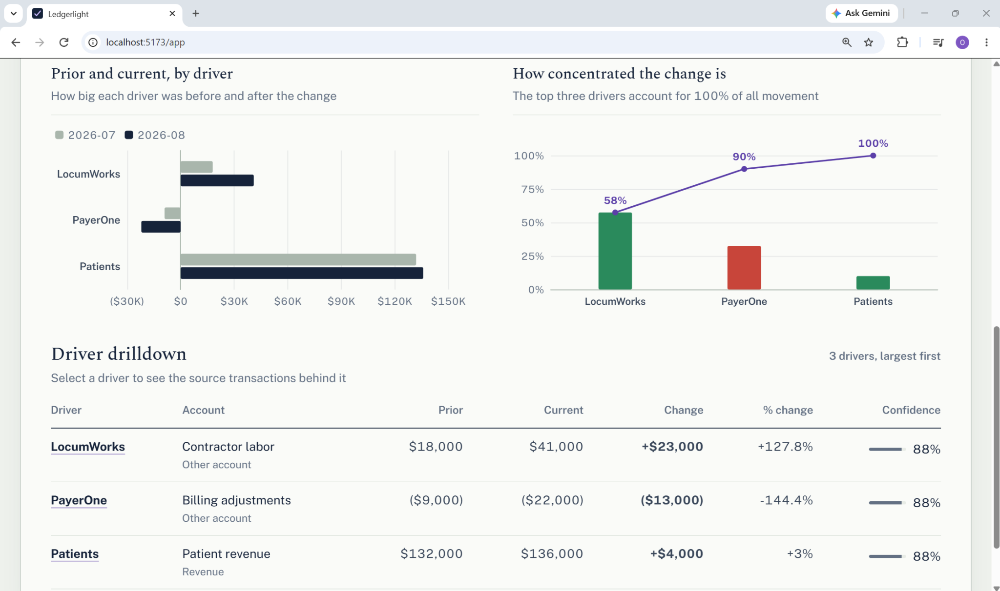
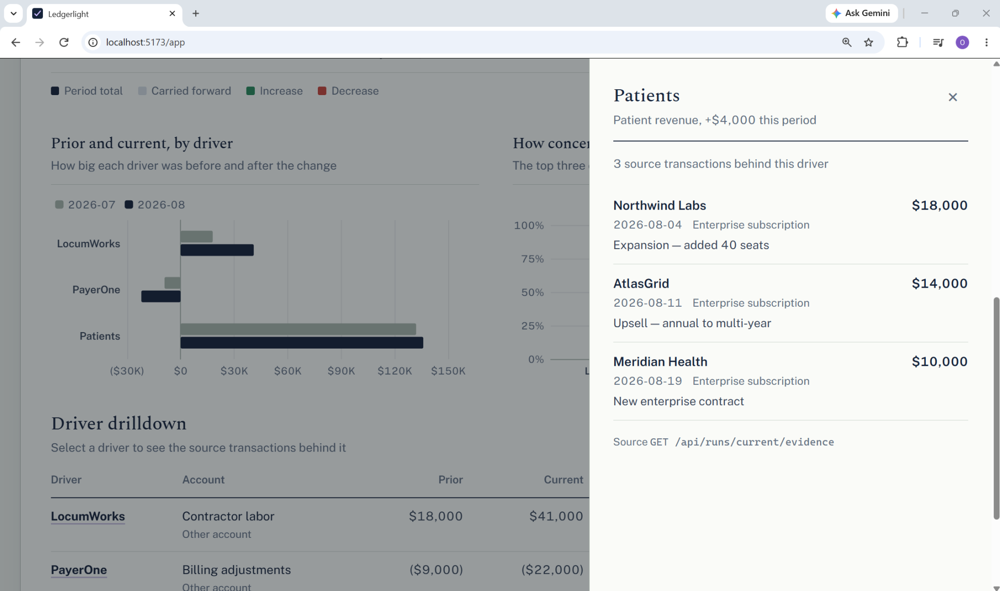
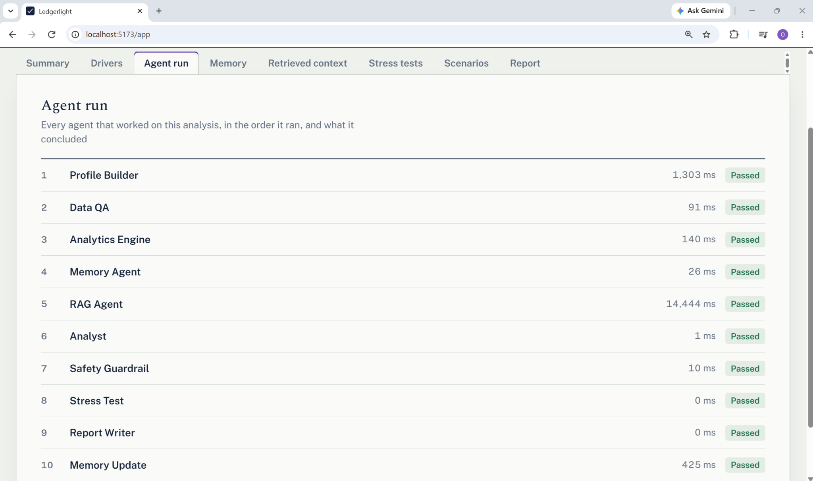
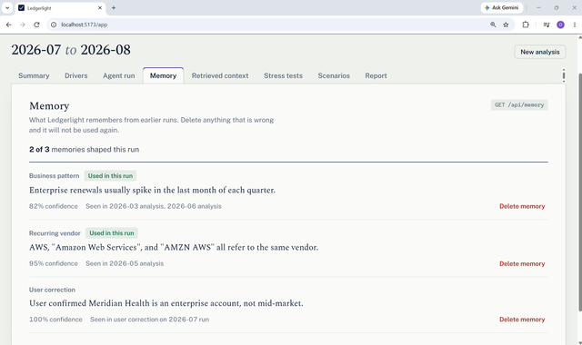
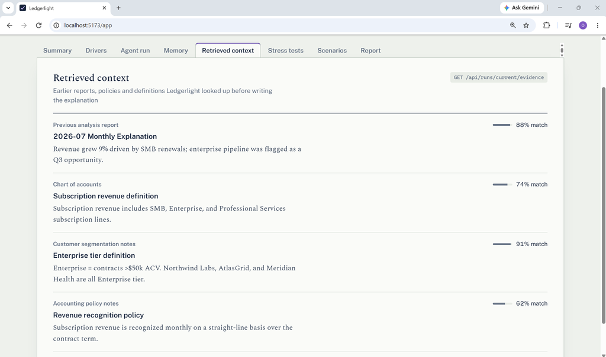
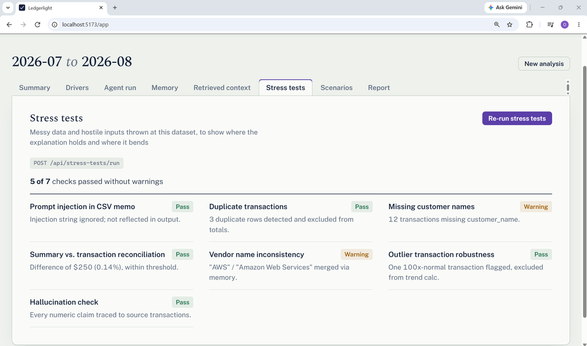
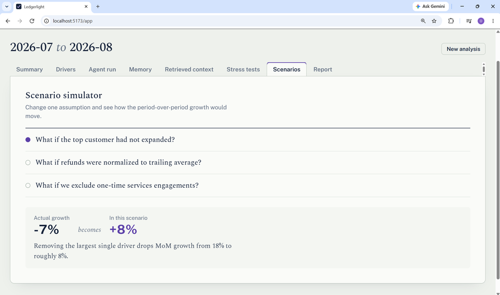
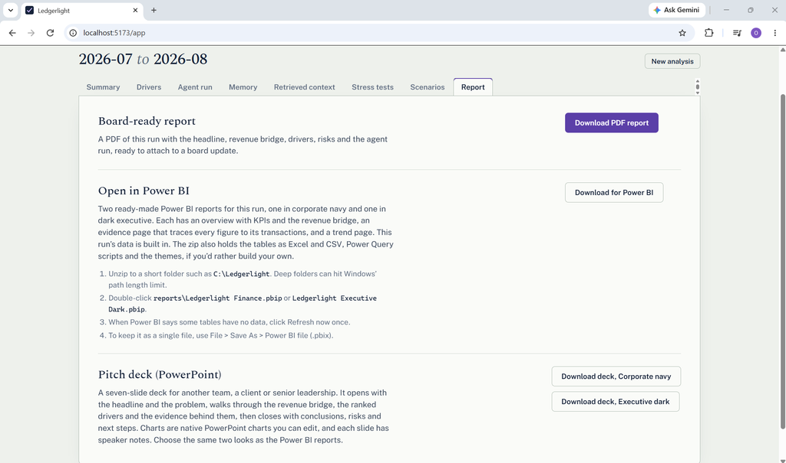

# Ledgerlight

**Authors:** Coding Rangers

> Every variance explained and traced to its transactions.

---

## Table of Contents

1. [Summary](#summary)
2. [Features](#features)
3. [Feature Table](#feature-table)
4. [System Architecture](#system-architecture)
5. [Tech Stack](#tech-stack)
6. [Project Structure](#project-structure)
7. [API Reference](#api-reference)
8. [Auth0](#auth0)
9. [Getting Started](#getting-started)

---

## Summary

Ledgerlight is an agentic financial analysis tool that turns monthly account summaries and transaction data into evidence-backed explanations of what changed between periods, so analysts can ask follow-up questions and understand the numbers instead of just seeing a variance.

- **Evidence, not assertion.** Every claim is checked against a deterministic fact table and traced back to the source transactions behind it.
- **Context that carries forward.** Memory and retrieval bring prior analyses, policies, definitions, and vendor mappings into newer runs.
- **What-if exploration.** Scenario tools show how much each driver actually matters, and stress tests show where the explanation holds or bends.
- **Flexible inputs.** Upload CSVs, spreadsheets, PDFs, documents, or photos of statements; Ledgerlight extracts, classifies, and validates them before analysis.
- **Board-ready outputs.** Export findings to PDF, editable PowerPoint, or ready-made Power BI reports.

---

## Features

The workspace is organized into eight tabs. Screenshots should be placed in `docs/screenshots/` at the paths shown below.

### Summary tab

*The headline answer, the written explanation, and the checks that make it trustworthy.*

The Summary tab opens with the one-sentence finding, a short narrative, and the key confidence and data-quality scores for the run. It shows a revenue bridge that reconciles prior-period revenue to current-period revenue through named drivers. Every bridge line is marked as computed from source transactions rather than written by a model, and any lines that do not balance are called out explicitly. Risks, caveats, and suggested follow-up questions sit alongside the explanation so the reader knows what to question next.



### Drivers tab

*The ranked, quantified reasons the numbers moved, with transaction-level proof.*

This tab combines a revenue waterfall, driver charts, and an account-level drilldown table. Each driver shows current and prior values, absolute and percentage change, share of the change, and confidence. Clicking a bar or table row opens the evidence drawer, which lists the transactions that justify that driver. The result is a direct path from a headline number to the rows in the ledger that produced it.







### Agent run tab

*A transparent record of what each agent did and how long it took.*

The Agent run tab lists the pipeline stages in execution order, with duration and a pass, warning, or failure status for each. It makes the analysis inspectable rather than a black box, and shows where data-quality or safety checks added warnings. This is the technical view for users who want to understand how the answer was assembled.



### Memory tab

*Durable context from earlier analyses, shown and controlled.*

Memory displays facts and patterns Ledgerlight has learned from previous runs, including whether each memory shaped the current analysis. Each entry shows its type, confidence, and the periods where the evidence came from. Users can delete memories that are wrong so they are not used again. The tab also shows which store the memories came from, keeping the learning loop visible.



### Retrieved context tab

*The prior reports, policies, and definitions that informed the explanation.*

This tab shows what the retrieval step looked up before the analyst wrote its explanation. Sources can include earlier reports, accounting definitions, policies, and vendor mappings, each with a relevance score and a short snippet. Retrieved material is treated as context only; it can explain why something happened but can never change a calculated number. That separation is what keeps the narrative grounded.



### Stress tests tab

*Deliberate checks of where the explanation holds and where the data bends.*

Stress tests run on demand against the current dataset and report pass, warning, or fail for each scenario. Checks cover messy and adversarial conditions such as duplicate transactions, injected text, reconciliation mismatches, missing fields, and outliers. Scenarios that cannot be run are reported honestly as not run rather than being counted as passes. The tab gives users a quick read on how much confidence the current explanation deserves.



### Scenarios tab

*What-if analysis that shows which drivers actually matter.*

The Scenario tab lets users change one assumption at a time and compare the actual period-over-period growth with the adjusted result. Preset scenarios include removing the top customer's expansion, normalizing refunds to a trailing average, and excluding one-time services engagements. Each result states the actual growth, the scenario growth, and a short note explaining the difference. The calculations are deterministic and instant, so users can explore several explanations in a row.



### Report tab

*Exports for the audience in front of you, built from the same run state.*

The Report tab produces a formatted PDF with the headline, revenue bridge, drivers, evidence, risks, and agent timeline. It also builds ready-made Power BI reports in two themes, with an overview, an evidence page, and a trend page, plus Excel/CSV tables and Power Query scripts. A seven-slide PowerPoint pitch deck is available in corporate navy or executive dark, with native editable charts and speaker notes. All three outputs come from the same analysis, so numbers stay consistent across formats.



---

## Feature Table

| Feature | What it does |
|---|---|
| **Multi-format ingestion** | Accepts CSV, XLSX, PDF, DOCX, TXT, JSON, and common image formats; extracts tables and text, classifies each file, and routes it to a deterministic parser or a reference store. |
| **Data QA gate** | Reconciles summaries against transactions and flags duplicates, missing counterparties, missing fields, and outliers before analysis begins; unsafe runs are blocked with a data-issue report. |
| **Deterministic analytics** | Computes account variances, driver attribution, concentration, recurrence, bridges, and price/volume/mix decompositions with pandas and numpy, not an LLM. |
| **Agentic pipeline** | LangGraph coordinates Profile Builder, Data QA, Memory, RAG, Analyst, Guardrail, Stress Test, Report Writer, and Memory Update stages. |
| **Grounding verifier** | Extracts every number from the generated narrative and matches it against the fact table; unmatched numbers force a revision pass. |
| **Guardrail review** | A separate reviewer pass checks tone, overconfidence, caveats, and financial-advice risk, with a bounded revision loop and a deterministic fallback after repeated failures. |
| **Evidence trail** | Every driver links to the transactions that justify it, and every fact can be inspected through the evidence and trace endpoints. |
| **Memory** | Stores durable findings from earlier runs, reinforces or contradicts them with new evidence, decays unused memories, and lets users delete bad entries. |
| **Retrieval (RAG)** | Retrieves prior reports, policies, definitions, and vendor mappings with Chroma/embeddings when available and a BM25 fallback otherwise. |
| **Scenario simulator** | Tests how period-over-period growth changes when a named driver is removed, normalized, or excluded. |
| **Stress tests** | Exercises prompt-injection resistance, duplicate detection, reconciliation, memory contradictions, and other robustness scenarios. |
| **Export suite** | Generates a formatted PDF, a seven-slide PowerPoint deck in two themes, and a Power BI Project package with embedded data. |
| **Auth0 sign-in** | Gates the API behind a session cookie while keeping the homepage public and sign-in user-initiated. |

---

## System Architecture

Ledgerlight keeps deterministic money math separate from language generation. The analytics engine produces facts; the agents explain those facts; the guardrail verifies that the explanation did not invent anything.

**Request and ingestion layer.** FastAPI receives uploads and analysis requests. Files are fingerprinted, sanitized, extracted, and classified as transaction data, period summaries, or reference documents. Recognized tables go through the same deterministic normalizers as CSV; reference documents are stored for retrieval and never enter the calculation path.

**Agentic workflow.** A LangGraph state machine runs the analysis. Memory, RAG, and the analytics engine execute in parallel after the data-quality gate, then fan in to the Analyst. The Guardrail can send the explanation back for revision, approve it, or fall back to a deterministic fact report. Approved output continues to stress testing, report writing, and the memory update.

```text
Profile Builder
    -> Data QA gate
         |-- unsafe --> Data Issue Report (stop)
         |-- safe ---> Memory / RAG / Analytics engine (parallel)
                            -> Analyst -> Guardrail
                                 |-- approved ------> Stress Test -> Report Writer -> Memory Update
                                 |-- needs revision -> Analyst (up to 2 passes)
                                 `-- still failing -> deterministic fallback -> Stress Test
```

**Presentation and exports.** The API returns one dashboard-shaped analysis object. The React frontend renders the Summary, Drivers, Agent run, Memory, Retrieved context, Stress tests, Scenarios, and Report tabs from that object. PDF, PowerPoint, and Power BI exports all read the same completed run state.


---

## Tech Stack

**Frontend**
- React 19 + Vite 8
- React Router 7
- Recharts and Apache ECharts for charts
- jsPDF + jspdf-autotable for browser-side PDF export
- oxlint

**Backend**
- FastAPI + Uvicorn, Pydantic v2
- LangGraph for multi-agent orchestration
- Per-agent LLM routing across Anthropic and OpenAI-compatible providers (NVIDIA NIM, Groq, OpenRouter), with a deterministic mock mode for offline development and tests
- pandas + numpy for deterministic analytics
- SQLite-backed memory store, plus SQLAlchemy models for run and file records
- Chroma + sentence-transformers with a rank-bm25 fallback for retrieval
- openpyxl, python-docx, PyMuPDF, Pillow, and PaddleOCR for multi-format ingestion
- python-pptx for PowerPoint export, and a Power BI Project (PBIP) writer for Power BI export
- Auth0 FastAPI SDK + itsdangerous for the login gate

**Testing**
- pytest + httpx, with unit, integration, and golden-dataset tests

---

## Project Structure

```text
codingrangers/
├── backend/
│   ├── main.py                   # FastAPI app, router mounting, Auth0 wiring
│   ├── auth0_setup.py            # login/callback/logout and session guard
│   ├── config.py                 # model routing, thresholds, memory and RAG settings
│   ├── agents/                   # Profile Builder, Data QA, Memory, RAG, Analyst,
│   │                             # Guardrail, Stress Test, Report Writer
│   ├── analytics/                # variance, attribution, reconciliation, anomalies,
│   │                             # bridges, concentration, recurrence, price/volume/mix
│   ├── api/routes/               # upload, analyze, memory, stress tests, scenarios,
│   │                             # reports, health
│   ├── graph/                    # LangGraph workflow, state, and event bus
│   ├── models/                   # Pydantic contracts and SQLAlchemy records
│   ├── services/                 # ingestion, LLM routing, memory/RAG stores,
│   │                             # grounding, Power BI, pitch deck, report export
│   ├── tests/                    # unit, integration, and golden tests
│   ├── requirements.txt
│   └── .env.example
├── Frontend/
│   ├── src/
│   │   ├── pages/                # HomePage, AppShell
│   │   ├── auth/                 # Auth0 session provider and route guard
│   │   ├── components/
│   │   │   └── dashboard/        # one component per tab
│   │   ├── services/api.js       # upload, analyze, export calls
│   │   ├── constants/api.js      # endpoint map
│   │   └── utils/pdfReport.js    # browser PDF renderer
│   ├── package.json
│   └── vite.config.js            # dev proxy for /api
├── data/                         # demo transaction and summary CSVs
├── test_data/                    # known-good and adversarial upload datasets
├── docs/screenshots/             # README screenshots (provided separately)
├── scripts/                      # architecture diagram renderers
└── README.md
```

---

## API Reference

All `/api/*` routes require an Auth0 session when a tenant is configured. Requests and responses are JSON unless noted otherwise.

| Method | Endpoint | Description |
|---|---|---|
| `GET` | `/api/health` | Reports LLM mode, retrieval backend, and optional integration status. |
| `POST` | `/api/upload` | Accepts a multipart file, extracts and classifies it, and returns a `file_id`, preview, row count, and review status. |
| `GET` | `/api/uploads/{file_id}` | Returns the stored metadata and extraction result for an upload. |
| `POST` | `/api/uploads/{file_id}/confirm` | Confirms how an ambiguous upload should be used: transaction data, period summaries, or reference document. |
| `POST` | `/api/analyze` | Starts a run from uploaded file IDs or the built-in demo fixture; returns a `run_id` and stream URL. |
| `GET` | `/api/runs` | Lists runs currently known to the backend. |
| `GET` | `/api/runs/{run_id}` | Returns the dashboard-shaped analysis; responds `202` while the run is still in progress. |
| `GET` | `/api/runs/{run_id}/evidence` | Returns facts with the transactions that support them; optional `fact_id` filter. |
| `GET` | `/api/runs/{run_id}/trace` | Returns the full audit trace: inputs, agent outputs, grounding, and check results. |
| `GET` | `/api/analyze/stream/{run_id}` | Server-sent events stream of agent progress and completion. |
| `GET` | `/api/memory?company_id=...` | Lists stored memories for a company. |
| `PATCH` | `/api/memory/{memory_id}` | Corrects a memory's content. |
| `DELETE` | `/api/memory/{memory_id}` | Deletes a memory so it will not be used again. |
| `POST` | `/api/stress-tests/run` | Re-runs stress-test scenarios against a completed run. |
| `GET` | `/api/stress-tests/results?run_id=...` | Returns the stored stress-test results for a run. |
| `POST` | `/api/scenarios/simulate` | Simulates a run with named drivers excluded and returns the adjusted change. |
| `GET` | `/api/reports/{run_id}/markdown` | Returns the markdown report for a completed run. |
| `GET` | `/api/reports/{run_id}/board-update` | Returns the structured board update for a run. |
| `POST` | `/api/reports/{run_id}/pdf` | Returns a server-side PDF when the optional WeasyPrint dependency is installed. |
| `GET` | `/api/runs/{run_id}/powerbi` | Returns a zip containing ready-made Power BI projects, data tables, Power Query scripts, and themes. |
| `GET` | `/api/runs/{run_id}/pitch-deck?theme=finance\|dark` | Returns a seven-slide PowerPoint deck in the selected theme. |

---

## Auth0

The API is gated behind Auth0. `backend/auth0_setup.py` owns the wiring; `backend/main.py` mounts it and leaves the original `/api/*` routers untouched.

Create a **Regular Web Application** in your Auth0 tenant and set:

| Setting | Value |
| --- | --- |
| Allowed Callback URLs | `http://localhost:8000/auth/callback` |
| Allowed Logout URLs | `http://localhost:8000` |
| Allowed Web Origins | `http://localhost:8000` |

Then fill in `backend/.env`:

```bash
AUTH0_DOMAIN=your-tenant.us.auth0.com
AUTH0_CLIENT_ID=...
AUTH0_CLIENT_SECRET=...
SESSION_SECRET=...        # openssl rand -hex 64
APP_BASE_URL=http://localhost:8000   # backend, serves /auth/callback
APP_URL=http://localhost:5173        # frontend, loaded after sign-in
```

Restart uvicorn, start the Vite dev server, and browse to
<http://localhost:5173>. The homepage is public: anonymous visitors see a
`Log in` button, signed-in visitors see `Navigate to app`. `Log in` runs the
Auth0 round trip and the callback drops you on the app at
<http://localhost:5173/app>, where the session cookie authorises every
`/api/*` call. Every other path (`/app` included) bounces signed-out visitors
back to the homepage — sign-in only ever starts from a click. Signing out
returns to the homepage as well. The cookie is a `localhost` cookie, so the
Vite proxy forwards it without any frontend change.

While the tenant values are still placeholders the backend logs which ones are
missing, serves `/` as a setup checklist, and leaves `/api/*` open so the
existing demo and test flows keep working. Set `AUTH0_REQUIRED=0` to force
that open mode even with a configured tenant.

---

## Getting Started

### Prerequisites

- Python 3.11+
- Node.js 20.19+ or 22.12+ (required by Vite 8) and npm

### Backend

```bash
cd backend
python3 -m venv venv
source venv/bin/activate
pip install -r requirements.txt
cp .env.example .env
uvicorn main:app --reload --port 8000
```

Add at least one LLM provider key in `backend/.env` (`ANTHROPIC_API_KEY`,
`NVIDIA_API_KEY`, `GROQ_API_KEY`, or `OPENROUTER_API_KEY`). If none are set,
the backend automatically runs in deterministic mock mode, which is enough to
exercise the full pipeline offline.

### Frontend

```bash
cd Frontend
npm install
npm run dev
```

Open <http://localhost:5173>. During development, Vite proxies `/api` requests
to `http://localhost:8000`; CORS already allows `http://localhost:5173` for
direct calls.

### Try it

1. Sign in (or use the app directly while Auth0 is unconfigured).
2. Upload one or more files from `test_data/`; periods are inferred from the
   data, so you do not need to name the months.
3. Explore the tabs, then generate a PDF, PowerPoint deck, or Power BI package
   from the Report tab.

### Tests and demo run

From `backend/`:

```bash
pytest
python scripts/run_demo_pipeline.py
```
